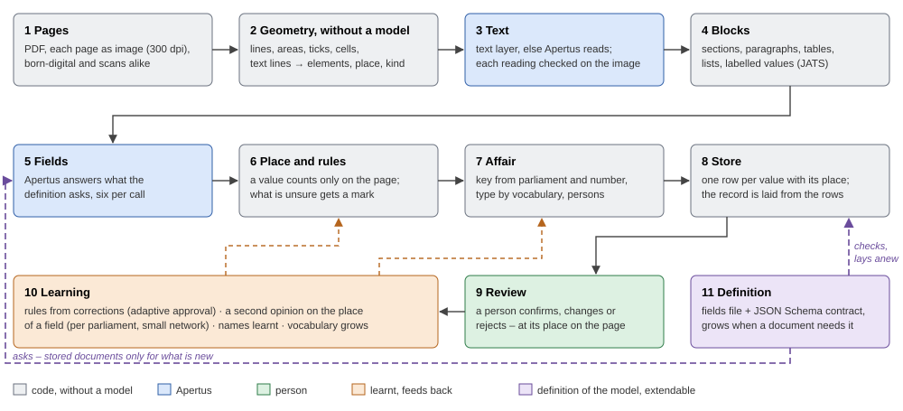

# Technical report — Docket

- **Track:** Track 2A — OpenParlData: Extracting Parliamentary Affairs from PDFs into One Common Structure
- **Event:** Online
- **Team:** Marcus Selzer, Tim Bärisch
- **Demo:** no video required; `make run` starts the app with the review and the visitor's part
- **Repository:** https://github.com/owldevltd/docket-apertus
- **Maturity:** between proof of concept and deployable prototype (reasons in 1)

## 1. Summary

In Switzerland, parliamentary affairs stand in hundreds of thousands of PDFs, born digital and scanned, in German,
French and Italian, and every parliament prints them differently. Docket turns such a PDF into an affair record and
attaches to every value the place on the page it came from. The approach turns the usual order around: first code
recognises without a model where what stands on the page; then Apertus 8B reads and answers; then code decides again
what counts – a value counts only if it stands on the page. Where the model guesses, Docket sets a mark for a person,
and what a person corrects, Docket learns as a rule for every case of the same kind.

On 300 documents from 62 parliaments, measured in a shuffled order, **209 of 299 (70 %, 95 % interval 64.5–74.8 %) run
through without a single mark**; the share holds still from 50 documents on and is similar in all three languages (67 to
72 %). To the question of the challenge: yes, if one separates what a document prints from what it means – for what is
printed, one common schema holds across parliaments, levels and languages; the meaning (type, state, number) stays
different per parliament and belongs in tables per parliament that grow with the store (5.5).

What Docket does differently:

- **First recognise, then read:** the geometry of the page comes without a model; no rules per layout that break on
  unfamiliar layouts.
- **A value counts only with its place:** what does not stand on the page is not taken; what is unsure is marked,
  not guessed.
- **A model that grows:** a fields file and a contract define the record; a new field or another standard lays itself
  over everything already read, without reading again.
- **It learns:** what a person corrects becomes a rule for every value of the same kind.

The criteria: insight, whether a common schema is feasible, in 5.5 and 2.3; breadth and applicability in 4 and 5.2;
technical rigour in 5 and the appendix `docs/appendix.md`; sovereign deployability in 3.1; implementation feasibility
in 1 (maturity), 3.1 and 7.

**Maturity: between proof of concept and deployable prototype.** The pipeline is a prototype: `make run` starts it in
Docker, it runs on real PDFs from beginning to end, it is measured on 300 documents from 62 parliaments and secured by
509 automatic checks (with the documents of the tests in place). The whole is a proof of concept: for operation it lacks
a system of rights and users (today one account for the administration), throughput (today one stream to the model; the
whole corpus needs parallel streams), better reading of scans and a measurement with own model weights (6).

## 2. Architecture

A document goes through ten stations; an eleventh defines the model (Figure 1). Four ideas carry them. Work began on 2
October 2026. The geometry and reading module was written on 3 and 4 October and ported on 6 October to both of our
submissions, Python for Docket (Track 2A) and Node for Trace (Track 2B); each port was checked against the original and
gives the same blocks (docs/evidence.md).

### 2.1 First recognise, then read

Every page goes as an image through the same geometry, born digital or scanned: lines, tinted areas, ticks, cells
and text lines are found without a model and become elements with place and kind (own code on the pixels). Where the
PDF has a text layer, its words go into the elements; otherwise Apertus reads the elements, three to a strip, and
every reading is checked against the image by the shape of its ink. From the elements, code builds blocks after JATS:
sections, paragraphs, tables, lists, labelled values, signatures. The model never decides where something stands and
never what a page is; it reads what it is shown and answers questions about a page it sees as text. Measured at the
start: without this guidance the model named, as the source of a value, a block that held not one word of the value
in 142 of 204 cases.

### 2.2 A value counts only with its place

Every answer has to find its place on the page; every value carries `source` with the document, the block (and through
it page and pixel box) and the way it got there:

| `how` | means | mark for a person |
|---|---|---|
| `literal` | stands so in the block; a day in any spelling of the same day | only where the block was read uncertainly |
| `derived` | every word stands in the named block, only put together differently | no |
| `cited` | the model names the block; only part of the words stand there | yes |
| `composed` | worded by the model (the summary) | only where it leaves its document |

A value without a place is not taken – the conservative extraction the briefing asks for. After the model, rules in
code decide: the place comes from the line the document is dated with, a value that is already another field's value
is left out, co-signers count only from the submission itself, a day only where it stands on the page.

### 2.3 A dynamic model with a contract

Docket does not fix a schema; it defines the model in two files (station 11): **the fields file** – what is asked, where
the value belongs and which rules apply to it – and **the contract**, a JSON Schema (version 0.8) against which an own
validator checks every record. The starting point is OpenParlData's API answer for an affair, unchanged; what it does
not hold comes in as keys from JATS: further header entries (`custom-meta`), related affairs and acts, the structure of
the document (`body`), the government's answer (`response`). 14 keys are fixed, 22 provided for; a new one comes in only
when a document needs it. Prior knowledge is a table, not the model: the number forms per parliament, the names of the
parliaments in every language, the names of sections, the types per label – built from OpenParlData's export and from
documents read earlier, shipped as data, never shown to the model.

**The model lays itself over everything already read.** Beside each record the store keeps one row per value: what it is
(body, number, person, place, date, event, text …), which field asked for it, how it was read, where it stands and what
a person decided. The record is laid from these rows at every build and checked against the contract, with every
decision; when Docket reads a document again, it finds the decisions on field, value and block again and puts them at
the new place. When a field is added, the app shows how many stored documents were never asked for it; a job asks only
them and only this field, over the stored pages, one call per document, and lays their affairs anew – nothing is read
again, no decision is lost, a second asking sends nothing (`tests/ask.py`). Another contract with its own fields file
gives the same affairs in another shape, also without reading again; a second contract with other keys and other nesting
is shipped and checked field by field against the first. A standard such as eCH-0295 or Akoma Ntoso would be exactly
that for Docket: one more fields file with a contract the store lays itself into. What Docket extracts, and in which
form it delivers it, changes without a line of code.

Every term is mapped onto OpenParlData and five standards and checked there (`docs/mapping.md`). What the model sees is
deliberately lean: more context did not help the 8B (the type of 72 documents right from the bare label 48 times, from
the first page as full element JSON 34 times, as lean JSON 39 times, as text 35 times).

### 2.4 Learning

Everything learnt lies in the store (Postgres), apart from the code, and acts back on the next run:

- **Adaptive approval.** Two corrections of the same kind by a person on the same field (a prefix removed, a digit for a
  letter, a spelling, the same value, a value beside a printed label) propose a rule; the app shows how many values it
  would change, and a person says yes. Then it applies to every fitting value, also to values without a mark and in
  documents read later; every application is visible on its own and can be taken back. A rule that a decision by hand
  contradicts is not proposed. Played through with 200 corrections on 60 documents: 50 right proposals, 3 wrong (without
  this check 54 and 44).
- **A second opinion on the place.** From the rows, Docket learns without a model where a field usually stands in the
  documents of a parliament, and a small network recognises the block of a field by its look (place, kind, font, length,
  digits – never words). The teachers are the model's readings and the people's decisions; every way is tried on
  documents held back and kept only where it is right more often than not (on 151 documents: 23 ways kept).
- **Register and vocabulary.** A printed name is looked up among the persons of its parliament; a name nobody holds is
  taken in as a learnt person from the third document on. The vocabulary (which name of a parliament means which type)
  is a stem a person extends in the app.

**Two levels.** Visitors only read the affairs in the schema: list, search, one affair, and the tables that follow from
them (participants, groups, meetings, events); a document page is set from its blocks, at their place, in their size and
font. Review and decisions, rules, vocabulary and register exist only in the administration, behind a sign-in once a
password is set. The app speaks German, French, Italian and English.

Everything is Python; the app (Angular) is built once. One container with the server and the queue, and Postgres.

## 3. Use of Apertus

- **Model:** swiss-ai/Apertus-v1.5-8B
- **How it is used:** inference – reading pages without a text layer, sorting the leftover elements, answering the
  fields, naming the kind of the document, writing a summary
- **Where it runs:** hosted endpoint at CSCS (OpenAI-compatible), temperature 0; exchangeable through `LLM_BASE_URL`

The questions stand in the fields file (`data/schema/fields.json`); every call starts with a line that is no field,
because the model likes to give the first line a value (measured: the first field was filled where nothing belongs). The
8B is enough because it only reads and quotes; the code judges. **Where it failed:** it maps the type of an affair
reliably neither from the label (44.8 %) nor from the page (47 to 54 %) – a table does that; it repeats itself at
temperature 0, so two equal answers are no sign of being right; what the building of blocks leaves over it sorts into
one of eight kinds, but in two runs it gave the same answer for only 64 of 150 places – there it is the lesser evil, not
a finding; asked whether a value set is right, it confirms and seldom says no – of 402 values it confirmed, 257 were
right (64 %); it invents days from month and year; it puts values into the wrong field. What works well: the kind of a
document from a closed list (51 of 60; held against the words of the page 56; the words alone 36). In the running system
no other model is used; in experiments the 70B served as a comparison.

### 3.1 Operation and external services

At runtime Docket contacts **exactly one external service**, the model endpoint; the text of the pages goes there and,
for pages without a text layer, images of single cuts of the page. The only input is PDFs; in operation Docket fetches
nothing from other sources. All calls go through one door: one after the other, half a second's pause after ten; after a
4xx the call is sent once more, and a second 403 or 429 halts the run; every call is kept with question, answer and
duration, so every value can be checked back to the model's answer. Run in Switzerland (CSCS). The first user would be
OpenParlData's extraction workbench with its import and review step; Docket is a container that runs beside it.

### 3.2 Cost and ten times as much

Measured: a document with a text layer needs 6 calls in the median, 7 507 tokens in and 436 out; one without a text
layer 28 calls. Computing takes 5.1 seconds a page on one core. 179 new documents of the measurement ran in 133 minutes
with 3 984 counted calls through one stream (about 5 000 with a ten-page scan that hit the time limit). **Ten times as
much**, 3 000 documents, would be about 67 000 calls and about 37 hours in one stream at that pace; the whole corpus
(907 472 documents) needs parallel streams, and the time falls with their number, because every document runs on its
own. Computing grows with the pages; how the model's time grows with the length was not measured. A scan needs about
five times the calls and tokens of a document with a text layer.

### 3.3 AI tools in development

We used an AI coding assistant during development (Claude Code by Anthropic). Following our instructions it wrote code
and ran and evaluated measurements. What is built, which rule stays after which number and what is released was decided
by the team; values the assistant set are marked in the docs as "set by the assistant, open". We reviewed every change
and committed it ourselves. Every measured number comes from a logged run; where a run is not kept in the repository,
`docs/tests.md` says so and how to repeat it. In the running system no language model works besides Apertus.

## 4. Data

The documents come from OpenParlData's corpus: 325 599 affairs and 907 472 documents in the API, documents from 97
bodies, all published by the parliaments themselves. Drawn with a fixed seed:

- **300 documents** for the evaluation: 60 reference documents and 240 more, about 100 per language, canton and
  municipality, five kinds of affair, 62 parliaments; 84 of the 299 measured without a text layer.
- **3 000 more** of the same kind for later tests (441 without a text layer).

The federal level is not included: its submissions are held as text (2 of 100 federal documents sampled were PDFs). The
documents name persons and are therefore **not in the repository**; `data/documents/README.md` says where the shipped
ones come from, `results/three-hundred/draw.json` lists the 300 by their OpenParlData ids. The register of persons is
loaded once at setup from OpenParlData's export (`tools/register.py`) and stays out of the repository; in operation
Docket fetches nothing.

## 5. Evaluation

The main measure, because it decides the effort in operation: **documents that run through without a mark for a
person**; and whether their values are right.

| Setup | Metric | Result |
|---|---|---|
| Model alone, every answer taken | values without a place | 1 454 of 6 500 (22 %) |
| Docket, only with a place | values literal or derived / marked | 4 650 / 211 |
| Docket, 300 documents | documents without a mark | 209 of 299 (70 %) |
| Docket, fields as in the reference | 60 developed on / 179 never seen | 78.3 % / 73.3 % |

### 5.1 Reference

60 documents, 20 each in German, French and Italian, 35 cantonal and 25 municipal, from 34 bodies (8 without a text
layer). The AI assistant read them field by field, every value with its page and its place; code found 718 of 762 quoted
pieces on the named page, and a team member checked the tables of the reading and 60 values drawn at random against the
documents (all 60 hold). Where Docket and the reading disagreed (609 values), each was judged by evidence from the
material (151), by one of eight rules (139) or by reading the place again (134); 185 rest on the reading alone. The
rules were set by the assistant and are open. The 60 are the documents we developed on; the other 239 of the 300 were
read the same way, without the judgement round, and give 73.5 % of the fields (95 % interval 72.1–74.8 %, drawing whole
documents), 73.3 % on the 179 never seen during development, against 78.3 % (75.6–80.9 %) on the 60
(`results/reference/`). The reference names people and is not in the repository.

### 5.2 Results

At the stations of the chain (299 documents): 215 (72 %) have a text layer, the kind of the document is named for 298,
the parliament found for 222 (74 %), the key built from the affair's number for 204 (68 %); the image check marks at
least one block in 54 documents. Without a mark run through 72 % in German, 71 % in French, 67 % in Italian (every
station: `results/three-hundred/`).

What holds the other 90: the image check (47, 34 of them only this), a value that stands only at the named block (42, of
them 35), a person found in the register one character off (12, of them 5). Without a mark does not mean without error:
in the reference documents without a mark, the values Docket set hold per field at 90–100 % (place, meeting, body,
title, type, kind of document, submitted on), 81–88 % (submitted by, parliament, event dates, addressee), 64–77 %
(number, co-signers, department) and 33–57 % (party, acts and references, related affairs, on behalf of; few values)
(`results/reference/`). A mark on the seven weak fields of 13 October (party, on behalf of, co-signers, department,
related affairs, acts and references, meeting) would have stopped 14 to 33 of the 41 reference documents that run
through without the register's mark, and would have hit more right values than wrong ones (on the seven fields 57 values
set, 22 wrong); it is not built. Adaptive approval comes in there (2.4).

### 5.3 How we tested

Every decision in the code rests on an experiment with numbers. The **appendix in the repository (`docs/appendix.md`)**
puts together the experiments behind the design, each with its number, decision and run; `docs/tests.md` records all 76
experiments, `docs/evidence.md` the series of measurements. Every rule after the model was tried, before it was kept, on
documents it had not come from; a third set of 151 documents caught a rule that way that would have built one person out
of two rows of a table of names. Played through today's code without the model, the stored answers give the same values
in 1 440 of 1 440 fields; `make test` checks 509 cases without a model and without the network (with the documents in
place).

### 5.4 A question across the parliaments

**How many members back an affair?** On the 299 documents from 62 parliaments, 153 name more than one person as
submitters or co-signers; the structured data hold at most one for 185 of 296 affairs. Per parliament this differs in
kind: a document from Graubünden names 33 members in the median, one from Neuchâtel 10, from Valais 2.5, from Ticino 2,
from most municipalities one. The question can be answered only from the documents; `make questions` answers it without
a model from the store (the numbers for the 300 in `results/three-hundred/`).

### 5.5 Is a common schema feasible?

A common schema is feasible if it separates two things: what a document prints, and what it means. The evidence:

- **What holds uniformly:** the head of the affair. Printed in 60 reference documents from 34 bodies: who submits 59,
  title and type 58, addressee 53, date 52, number 43, place 23, party 15, co-signers 14, department 8. Everything has a
  place in the schema and is read in all three languages with the same questions.
- **What comes together when collected:** the labels of the types run out; mixed, after 5 000 affairs 98.8 % carry a
  label already seen. Of 735 established labels, 6 stand for more than one type.
- **Where fundamental differences remain:** the types themselves (44 labels carry more than one harmonised type across
  the corpus; the 18 harmonised types are provisional according to the challenge owner), the states of an affair (463
  different ones, not comparable across parliaments), the numbers (every parliament has its own forms; 68 % of keys from
  the number), the levels (the federal level holds its submissions as text).
- **What the schema does with that:** what does not apply to all stands as a named header entry with the document; the
  schema grows only when a document needs it; harmonisation is done through tables per parliament, not in the model.

What is printed – who submits, title, type, date, number, addressee, the participants, the course – has the same
place in all 62 parliaments of our measurement and is read in all three languages with the same questions; for that,
OpenParlData's record suffices, completed by a few keys from JATS. The meaning – which type an "Auftrag" in Graubünden
or an "Anzug" in Basel is, which state an affair has reached, how its number is built – is not the same across the
parliaments and can be derived reliably neither from the document alone nor by the model; it belongs in tables per
parliament that a person maintains and that grow with the store. Fundamentally different remain the states and the
federal level. A common schema therefore does not have to be complete but extendable: Docket adds a key only when a
document needs it, and lays it over everything already read.

## 6. Limitations

- **Scans:** the model had to read 84 of the 299 documents; values placed in blocks the image check marks are right at
  67 % (39 of 58), in read blocks without the mark at 95 % (20 of 21), in documents with a text layer at 79 %
  (`results/reading-threshold/`).
- **Weak fields** run through without a mark (5.2); adaptive approval repairs errors of form, not a value in the wrong
  field.
- **Key:** without a readable number a document gets a weaker key from place, date and title.
- **Throughput:** one stream to the model; parallel streams and own model weights are not measured.

## 7. Reproducibility

The 300 documents were measured at commit `cc7a4da` (`results/three-hundred/result.md`). `make run` starts the server
and Postgres in Docker (the app on port 8080) with `LLM_NAME`, `LLM_BASE_URL`, `LLM_API_KEY` from the environment or
`.env`. On a clean checkout the store is empty: a PDF uploaded in the administration goes through the whole chain with
this key; the documents of the tests are put back as `data/documents/README.md` says. `make test` runs without a model
and without the network (509 checks with the documents in place; without them, the checks that need none); The 240 drawn
documents with seed 20261011, the order of the run shuffled with seed 20261013. Measured on an Intel Core i5-1135G7 (4
cores, 8 threads) with 8 GB of memory (6.9 GB usable), the model at CSCS.

## 8. Next steps

Measure parallel streams and own weights; read scans better; check values against public registers (addresses,
municipalities, companies); have the reference checked by a second person; put Docket as a container into OpenParlData's
workbench.

## License

Code: Apache 2.0. This report: Creative Commons Attribution 4.0 (CC-BY-4.0).

## References

Hack Apertus 2026, Track 2A, OpenParlData challenge: "Extracting Parliamentary Affairs from PDFs into One Common
Structure" · OpenParlData, API v1 (api.openparldata.ch) and daily exports, CC BY 4.0 · JATS 1.3 (NISO), Archiving and
Interchange Tag Set · Akoma Ntoso (OASIS LegalDocML), `akomantoso30.xsd` · Parla-CLARIN (TEI) · Popolo · Docling,
docling-core · eCH-0295, draft · Apertus v1.5, Swiss AI Initiative (huggingface.co/swiss-ai).
